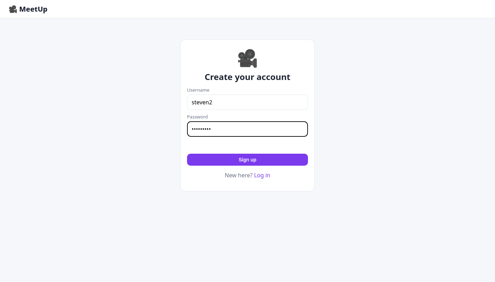
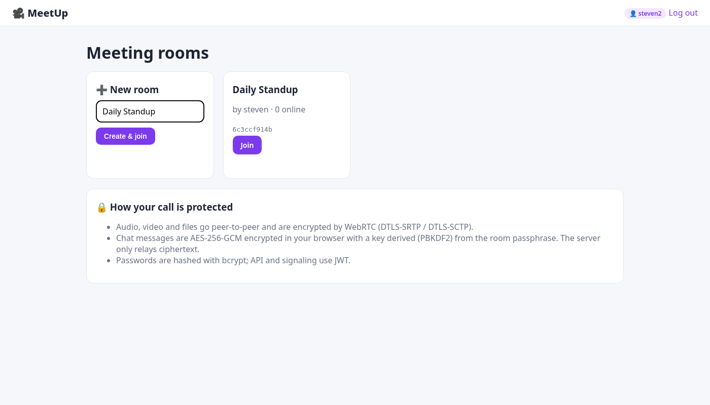
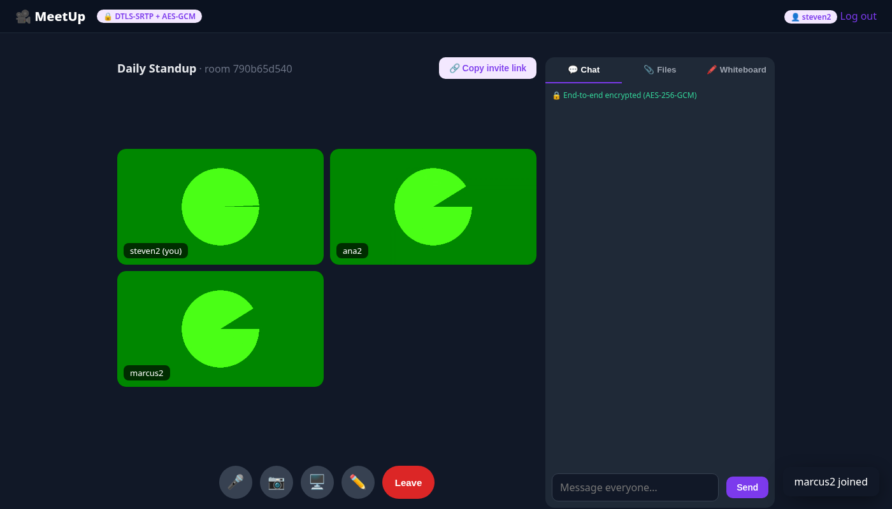
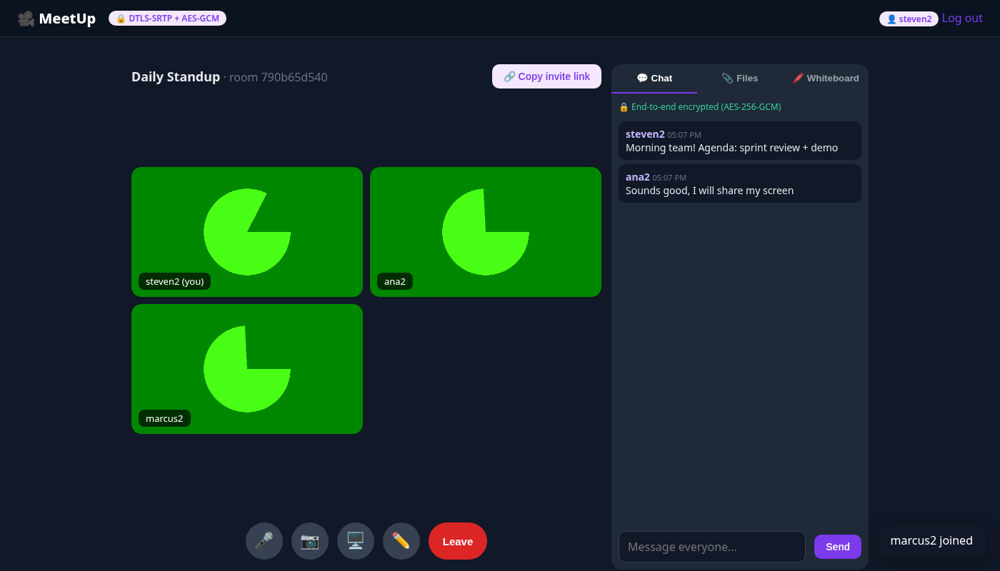
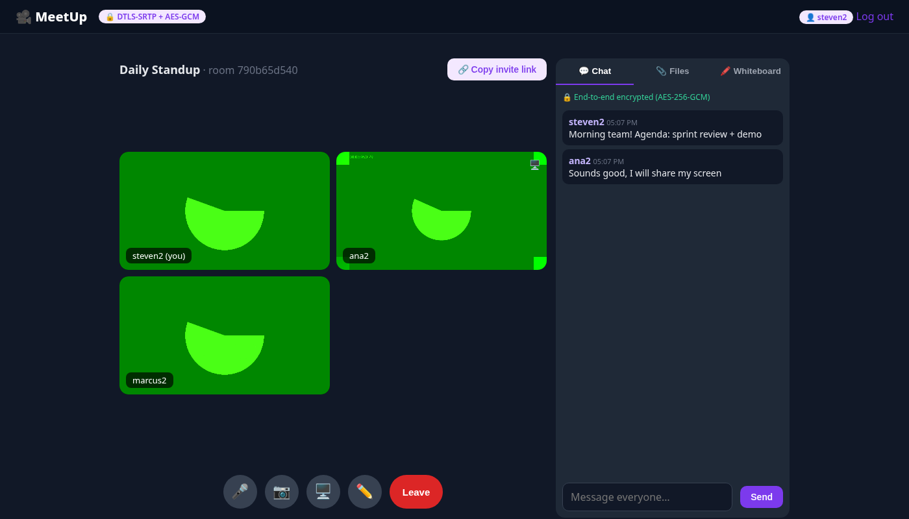
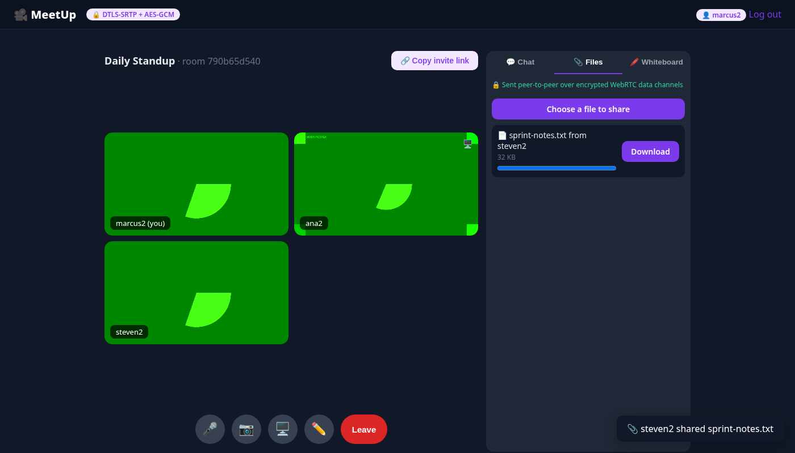
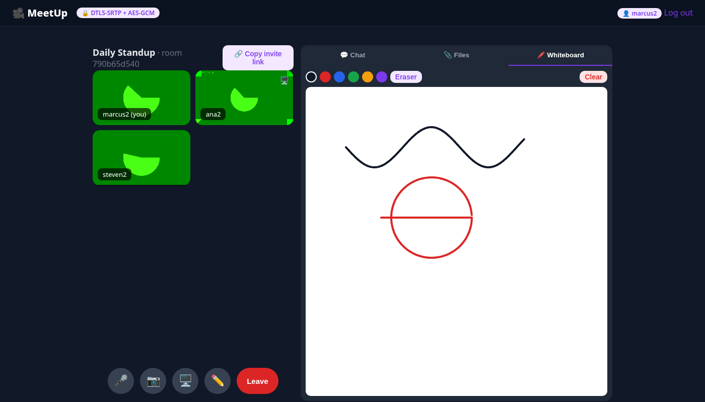

# MeetUp — Real-Time Communication App

CodeAlpha Full Stack Development Internship — **Task 4: Real-Time Communication App**


## Features

- User authentication (bcrypt + JWT) and meeting rooms with shareable invite links
- Multi-user video calls over WebRTC (mesh, up to 6 participants by default)
- Mute / camera toggle with live status indicators for everyone
- Screen sharing (`getDisplayMedia`, swapped in with `replaceTrack` — no renegotiation)
- **End-to-end encrypted chat**: AES-256-GCM, key derived with PBKDF2 from a room passphrase stored only in the URL fragment (`#/r/<room>/<passphrase>`), so the server only relays ciphertext
- Peer-to-peer file sharing over WebRTC data channels (DTLS-encrypted, chunked)
- Collaborative whiteboard synced in real time (colors, eraser, clear)
- Socket.IO signaling with JWT auth; peers can only signal within their own room

## Tech stack

- **Backend:** Node.js 20+, Express 5, SQLite (better-sqlite3), Socket.IO
- **Auth:** bcrypt password hashing (bcryptjs) + JSON Web Tokens
- **Frontend:** vanilla HTML, CSS and JavaScript (single-page app, no framework)
- **Tests:** Node's built-in test runner + Supertest — 6 tests, run on GitHub Actions (Node 20 & 22)

## Getting started

```bash
git clone https://github.com/x3r01432/CodeAlpha_RealTimeCommunicationApp.git
cd CodeAlpha_RealTimeCommunicationApp
npm install
npm start
```

Open <http://localhost:3000>. The SQLite database (`meet.db`) is created automatically on first run.

Configuration (optional environment variables): `PORT` (default 3000), `JWT_SECRET` (set this in production — otherwise a random secret is generated on each start), `DB_FILE`.

```bash
npm test
```

## API overview

- `POST /api/auth/register`, `POST /api/auth/login`, `POST /api/rooms`, `GET /api/rooms/:id`, `GET /api/config`
- Socket.IO: `join`, `signal`, `chat`, `media-state`, `wb:stroke`, `wb:clear`, `leave`

## Security & deployment notes

- Browsers only allow camera, microphone and screen capture on **HTTPS** (or `localhost`). For a LAN or production deployment either put the app behind a TLS reverse proxy or start it with `SSL_KEY=/path/key.pem SSL_CERT=/path/cert.pem npm start`.
- Media and data channels are always encrypted by WebRTC (DTLS-SRTP). Chat is additionally end-to-end encrypted in the browser; the passphrase never reaches the server.
- NAT traversal uses Google's public STUN server. For restrictive networks set `TURN_URL`, `TURN_USERNAME`, `TURN_CREDENTIAL`.
- `MAX_PEERS` (default 6) caps room size because a mesh call sends a stream to every participant.

## Screenshots

**Login**



**Lobby**



**Video call 3 people**



**Encrypted chat**



**Screen share**



**File received**



**Whiteboard synced**



**Whiteboard drawer**


## Author

**Steven Manuel Rios** ([@x3r01432](https://github.com/x3r01432)) — built for the CodeAlpha Full Stack Development internship.

## License

[MIT](LICENSE) © 2026 Steven Rios
